# Garde-robe Blue Box

Toutes les pièces achetées au magasin Blue Box depuis juin 2026. Le but : être habillé 100 % magasin quand je travaille, pour mettre la collection en avant.

**16 pièces** : Tommy Jeans 9 · Levi's 4 · Teddy Smith 3.

## L'appli

Ouvre `index.html` dans un navigateur (double-clic sur le fichier, rien à installer). La page est rangée en cinq onglets, en haut sur ordinateur, en bas sur téléphone et tablette. Le bouton « Ajouter un achat » reste en haut, quel que soit l'onglet.

**Aujourd'hui**
- **Ma tenue** : jusqu'à 5 pièces (sous-couche, pull, veste ou blouson, bas, chaussures), avec les raisons pour lesquelles elles vont ensemble. « Autre tenue » en propose une autre ; sous chaque pièce, « Changer » remplace seulement celle-là et « Au lavage » la sort des tenues. « Je l'ai portée » la note au journal, « Favori » la garde, « J'aime » et « Pas pour moi » apprennent tes goûts (une association notée deux fois « pas pour moi » n'est plus proposée). « Carte à partager » en fait une image 1080 × 1350 pour une story.
- **Réglages du jour**, à côté de la tenue : la météo (froid, frais, doux ou pluie) règle les couches d'aujourd'hui seulement ; sous la pluie, les bas clairs, les vestes légères et le daim reculent. Les couches (« 1 · un haut », « 2 · sous-couche + pull », « 3 · + veste ou blouson ») se règlent par défaut selon le mois et valent pour la tenue, la semaine et « Choisir une pièce ». La marque mise en avant au magasin s'y affiche quand il y en a une.
- **Choisir une pièce** : touche la pièce qui te fait envie. La page compose jusqu'à 5 tenues autour d'elle, explique pourquoi, et « Porter aujourd'hui » en fait ta tenue.
- **Mes favoris** : tes tenues gardées, à remettre en un geste. Une tenue remise à la main (favori, styliste, journal) reste celle que tu as choisie : la météo ou la marque mise en avant ne la recomposent pas ; sous la pluie, seul un bas clair est remplacé par un bas foncé.
- **Demander au styliste** (page publiée) : pose tes questions à Claude, qui connaît ta garde-robe, ton journal, tes envies et la météo du jour ; les tenues qu'il propose se portent en un geste. « Avis du styliste », sous ta tenue, la commente. Chaque demande utilise ton propre compte Claude et demande ton accord la première fois.

**Ma semaine**
- **Ma semaine** : coche tes jours de travail. Chaque jour reçoit un haut différent, les bas et les sous-couches tournent pour que toute la collection passe dans la semaine. Chaque jour a son bouton « Changer ». Chaque lundi, la semaine repart de zéro : les jours déjà portés reprennent la tenue notée au journal, les autres sont recomposés avec la rotation. Les jours passés ne sont plus modifiés.
- **Ce que j'ai porté** : le journal, sous forme de calendrier, le détail de chaque jour et les pièces oubliées (pas portées depuis trois semaines). Les pièces portées ces deux dernières semaines reviennent moins vite dans les propositions.

**Mes vêtements**
- **Mes vêtements** : toutes les pièces, filtrables par catégorie, avec le lien vers la fiche produit, « Porter avec… », « Au lavage », et pour les pièces ajoutées « Modifier » et « Supprimer ».
- **Ajouter un achat** (sur la page publiée, pour le propriétaire) : choisis la photo, le titre et les champs se remplissent tout seuls ; « Remplir avec Claude » reconnaît la pièce sur la photo. Recadre, valide.
- **Ce qui va ensemble** : toutes les combinaisons haut × bas, et un tableau des sous-couches, notées « valeur sûre », « possible » ou « à éviter ». Une case touchée montre la tenue en grand dans « Aujourd'hui ».

**Shopping**
- **Avant d'acheter** : décris la pièce que tu regardes en magasin ; la page montre ce qu'elle t'apporterait (nouvelles tenues, sous-couches, et les tenues elles-mêmes), avec le prix par nouvelle tenue.
- **Mes envies** : les pièces repérées, classées selon le rapport prix / nouvelles tenues. « Je l'ai acheté » ouvre le formulaire d'ajout pré-rempli.
- **Mon budget** : ta remise employé et ton budget du mois.
- **Ce qu'il me manque** : les catégories encore vides, par ordre de priorité.
- **Les achats les plus utiles** : les pièces qui ouvriraient le plus de nouvelles tenues.
- **Rentabilité** : le coût par port de chaque pièce (prix payé ÷ nombre de fois portée).

**Au magasin**
- **Marque mise en avant** : l'opération du moment (une marque jusqu'à une date). Les tenues de la semaine la favorisent jusqu'à cette date, ses bas et ses chaussures peuvent revenir plusieurs jours.
- **Mes photos en tenue** : tes photos, rangées avec la tenue notée ce jour-là.
- **Mes chiffres** : pièces les plus portées, marques, couleurs, jours notés par mois, et l'export du journal en tableur.

Une adresse qui finit par le nom d'un onglet (`#semaine`, `#shopping`…) ouvre directement cet onglet.

### Les règles de superposition

- Un t-shirt, une chemise ou un polo se porte sous un pull ou un sweat ; un t-shirt se porte aussi sous une chemise ouverte.
- Col de chemise sorti sur un col rond, glissé dans un zip ou visible dans un col V : valeur sûre. Sous une capuche : possible. Sous un pull col polo : à éviter (deux cols l'un sur l'autre).
- Ce qui dépasse doit se distinguer : même couleur que le pull, ou deux teintes foncées, et le col disparaît. Deux couleurs franches ou deux motifs superposés : à doser.
- Par-dessus : jean sur jean du même bleu à éviter, de deux bleus différents seulement possible ; une veste de la même couleur que le haut se fond dans la tenue.

Sur la page publiée, la semaine, le journal, les pièces au lavage, les favoris et les goûts sont enregistrés dans la page : ils sont les mêmes sur ton téléphone et ton ordinateur, et seul le propriétaire peut les modifier. Ouverte en fichier local, la page les garde dans le navigateur. Les 16 premières pièces sont dans `garde-robe.js`.

## Inventaire

### Pantalons (1)

| | Marque | Modèle | Couleur | Fiche |
|---|---|---|---|---|
| 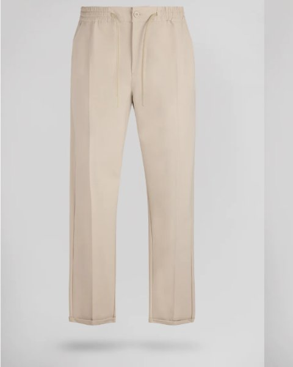 | Teddy Smith | Pantalon Pywan 17 Mixed (slim, taille élastique) | Beige | [teddy-smith.com](https://www.teddy-smith.com/products/pantalon-pywan-17-mixed-beige) |

### Jeans (5)

| | Marque | Modèle | Couleur | Fiche |
|---|---|---|---|---|
| 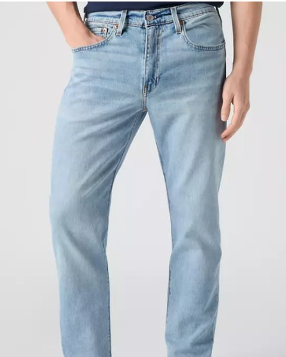 | Levi's | Jean 502™ Taper · 29507-0053 | Bleu clair | [levi.com](https://www.levi.com/FR/fr_FR/vetements/vetements-homme-levis/jean-502TM-taper/p/295070053) |
| 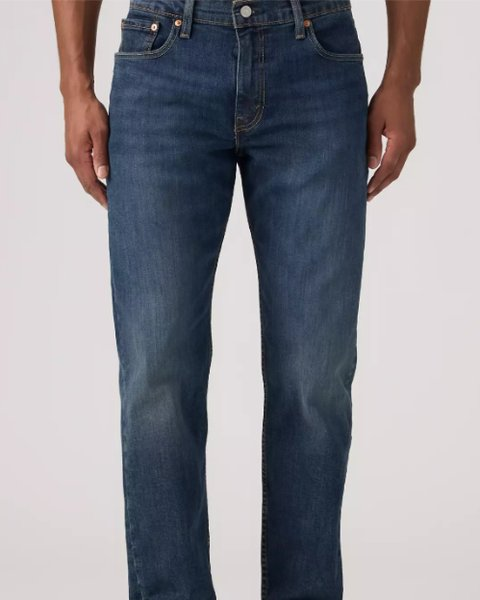 | Levi's | Jean 502™ Taper · 29507-1417 (Call It Off) | Bleu moyen | [levi.com](https://www.levi.com/FR/fr_FR/vetements/vetements-homme-levis/jeans/fuseles/jean-502TM-fusele/p/295071417) |
| 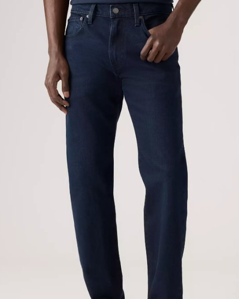 | Levi's | Jean 502™ Taper · 29507-1420 | Bleu marine | [levi.com](https://www.levi.com/FR/fr_FR/vtements/vtements-homme-levis/jeans/fusels/jean-502TM-fusele/p/295071420) |
| 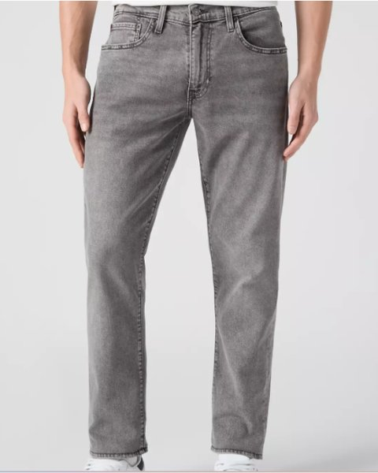 | Levi's | Jean 502™ Taper · 29507-1926 | Gris moyen | [levi.com](https://www.levi.com/FR/fr_FR/vetements/vetements-homme-levis/jeans/fuseles/jean-502TM-taper/p/295071926) |
| 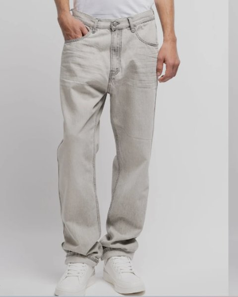 | Teddy Smith | Jean Memphis Straight (relaxed) | Gris clair | [teddy-smith.com](https://www.teddy-smith.com/products/pantalon-memphis-straigh-gris-clair) |

### Pulls (10)

| | Marque | Modèle | Couleur | Fiche |
|---|---|---|---|---|
| 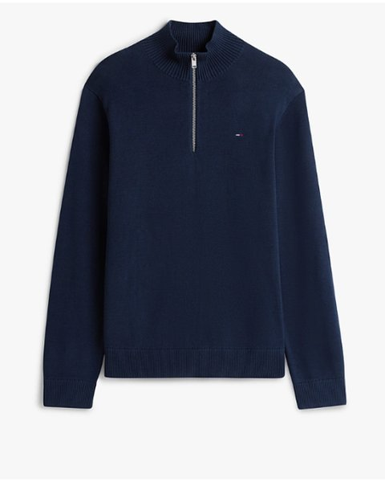 | Tommy Jeans | Pull slim Tommy Flag zippé léger (1/4 zip) · DM0DM21654 C1G | Bleu marine | [tommy.com](https://fr.tommy.com/%E2%80%A2-pull-slim-tommy-flag-zipp%C3%A9-l%C3%A9ger-dm0dm21654c1g) |
| 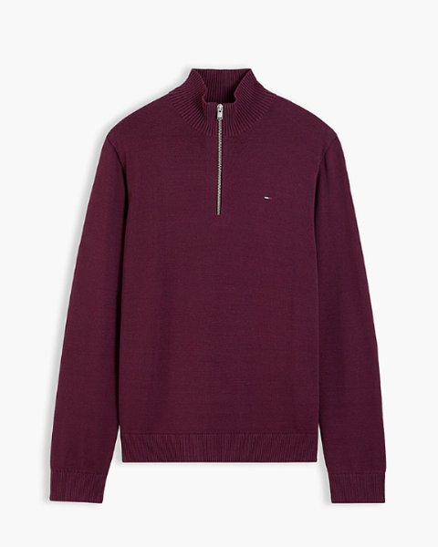 | Tommy Jeans | Pull slim Tommy Flag zippé léger (1/4 zip) · DM0DM21654 V11 | Bordeaux | [tommy.com](https://fr.tommy.com/%E2%80%A2-pull-slim-tommy-flag-zipp%C3%A9-l%C3%A9ger-dm0dm21654v11) |
| 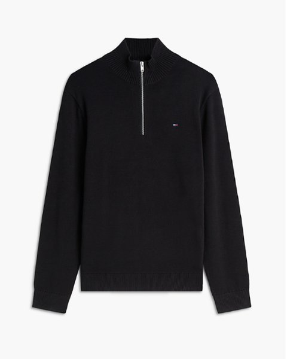 | Tommy Jeans | Pull slim Tommy Flag zippé léger (1/4 zip) · DM0DM21654 BDS | Noir | [tommy.com](https://fr.tommy.com/%E2%80%A2-pull-slim-tommy-flag-zipp%C3%A9-l%C3%A9ger-dm0dm21654bds) |
| 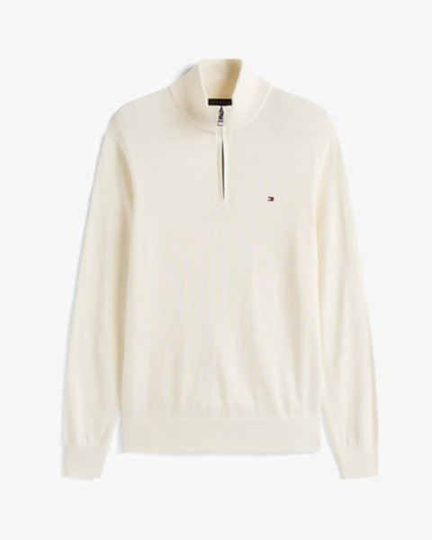 | Tommy Jeans | Pull slim Tommy Flag zippé léger (1/4 zip) · DM0DM21654 YBH | Beige | [tommy.com](https://fr.tommy.com/%E2%80%A2-pull-slim-tommy-flag-zipp%C3%A9-l%C3%A9ger-dm0dm21654ybh) |
| 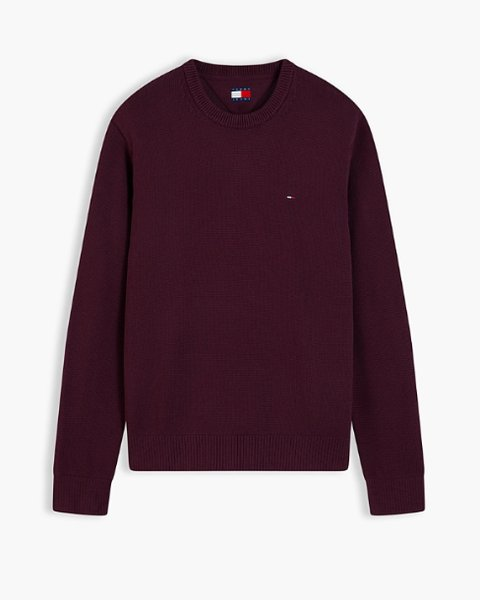 | Tommy Jeans | Pull slim texturé à drapeau Tommy (col rond) · DM0DM21787 V11 | Bordeaux | [tommy.com](https://fr.tommy.com/pull-slim-textur%C3%A9-%C3%A0-drapeau-tommy-dm0dm21787v11) |
| 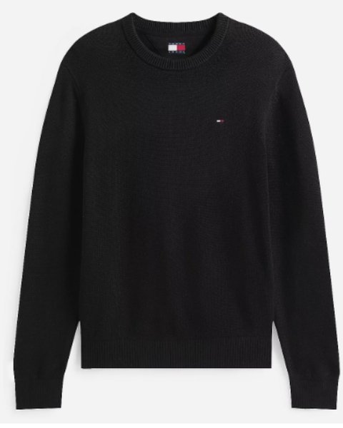 | Tommy Jeans | Pull slim texturé à drapeau Tommy (col rond) | Noir | [blackstore.fr](https://www.blackstore.fr/pull_homme_slim_ess-tommy_jeans-p-M217870A8J/) (revendeur) |
| 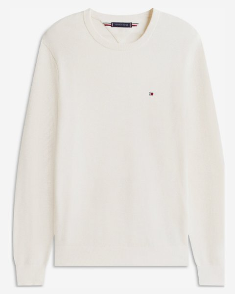 | Tommy Jeans | Pull slim texturé à drapeau Tommy (col rond) · DM0DM21787 YBH | Beige | [tommy.com](https://fr.tommy.com/pull-slim-textur%C3%A9-%C3%A0-drapeau-tommy-dm0dm21787ybh) |
| 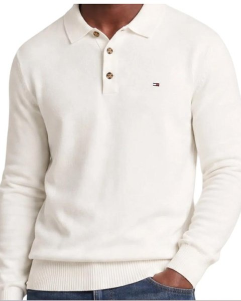 | Tommy Jeans | Pull col polo Slim Essential | Beige | [espace-des-marques.com](https://www.espace-des-marques.com/fr/197858/polo-beige-homme-tommy-hilfige-slim-essential) (revendeur) |
| 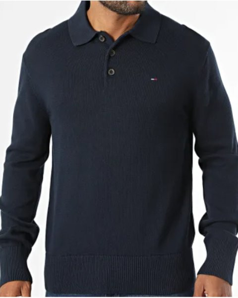 | Tommy Jeans | Pull col polo Slim Essential | Bleu marine | [laboutiqueofficielle.com](https://www.laboutiqueofficielle.com/p/tommy-hilfiger-pull-slim-essential-0304-bleu-marine-510785) (revendeur) |
| 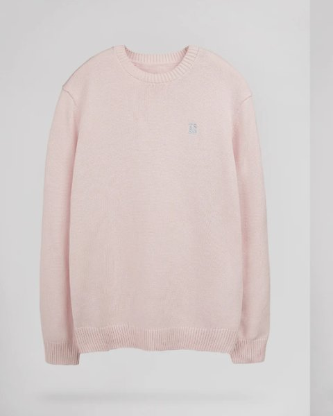 | Teddy Smith | Pull en coton P-Jimmy (col rond) | Rose | [teddy-smith.com](https://www.teddy-smith.com/products/pull-p-jimmy-pink-shirt) |

### T-shirts, chemises, vestes, blousons, chaussures

Aucun pour l'instant.

## Ce que ça donne

Avec 6 bas et 10 pulls, il y a **58 tenues possibles sur 60, dont 46 valeurs sûres**. La seule association à éviter, c'est un pull marine (zippé ou col polo) avec le 502 bleu marine, parce que les deux bleus foncés se confondent.

Il manque les chaussures pour qu'une tenue soit entièrement achetée au magasin.

## À compléter, par priorité

1. **Chaussures.** Je les porte à chaque service. Des baskets blanches en cuir iraient avec les 6 bas et les 10 pulls. Plus tard, une paire sombre (daim marron ou noir) pour l'hiver.
2. **T-shirts.** Je les porte sous chaque pull, et on les voit à l'encolure des 4 pulls zippés. Deux ou trois basiques : blanc, gris chiné, noir.
3. **Chemises.** Une Oxford blanche ou bleu ciel, col sorti sous les 4 pulls col rond, donne une deuxième version de chacune de ces tenues.
4. **Vestes.** Une surchemise kaki ou marine se garde sur le dos en magasin, et les clients la voient.
5. **Blousons.** Utile pour le trajet, mais on le voit peu pendant le service. Un modèle marine ou noir passe avec toute la palette.

## Ajouter un achat

**Depuis la page publiée (le plus simple).** Bouton « Ajouter un achat » en haut de la page :

1. Choisis la photo. Si le fichier s'appelle comme tes exports Canva (`Marque - Catégorie - Modèle - Couleur.png`), le titre et tous les champs se remplissent seuls. Sinon, tape le titre au même format.
2. Fais glisser la photo pour centrer la pièce dans le cadre, et zoome si besoin.
3. Vérifie la catégorie et la « couleur de référence », note si tu veux le prix payé, la date d'achat et la taille, puis valide.

La pièce apparaît aussitôt dans « Mes vêtements », les tenues, la semaine et « Ce qui va ensemble ». Elle est enregistrée dans la page elle-même (base de données et stockage photo de la page), pas dans ce dépôt. Seul le propriétaire de la page peut ajouter, modifier ou supprimer des pièces. Les autres personnes qui ont accès à la page les voient sans pouvoir les changer.

Catégories reconnues dans le titre : pantalon, jean, pull, t-shirt, chemise, veste, blouson, manteau (et parka, caban, trench), chaussures (et baskets, sneakers, boots…), sweat, polo, short, accessoires. Une couleur « à carreaux », « rayée » ou « imprimée » est classée en motif. Si une couleur n'est pas dans le tableau des accords, des règles générales s'appliquent : deux teintes foncées de la même famille se confondent, deux tons clairs proches manquent de contraste, deux couleurs franches sont à doser.

**Dans ce dépôt.** Pour qu'une pièce fasse partie des données du dépôt :

1. Mettre la capture d'écran dans `images/captures/`, et une vignette recadrée en 4:5 (480 × 600 px) dans `images/`.
2. Ajouter la pièce dans la liste `articles` de `garde-robe.js`, en reprenant le format des autres.
3. Pour une nouvelle couleur de bas ou de haut, ajouter aussi sa ligne ou sa colonne dans `accords`.

Claude peut recopier dans le dépôt les pièces ajoutées depuis la page.

## Publier la page

La page publiée sur claude.ai est `index.html` sans son enveloppe de document, que le visualiseur ajoute lui-même : `outils/version-artefact.sh > garde-robe-blue-box.html`, publiée avec `app.js`, `garde-robe.js` et `images/*.jpg`, et les capacités `db` (écriture réservée au propriétaire), `assets`, `user`, `sample` (avec images) et `downloads`.

Dans la base de la page : `achats` (pièces ajoutées), `etat/semaine` (semaine datée de son lundi, couches, météo, tenue du jour et si elle a été choisie à la main), `journal/AAAA-MM-JJ`, `pieces/<id>` (lavage, prix payé, date d'achat, taille), `favoris`, `gouts/accords`, `envies`, `reglages/general` (remise, budget), `vitrine/operation`, `lookbook`.

## Notes

- Les liens ont été nettoyés des paramètres de suivi publicitaire (`gclid`, `utm_*`, etc.).
- Trois pulls n'ont pas de fiche sur le site de la marque, leur lien mène chez un revendeur : le col rond noir, et les deux cols polo.
- La correspondance entre les références Levi's et les couleurs suit l'ordre de la liste d'achats et des captures. Le 29507-1417 « Call It Off » est confirmé comme un délavage moyen.

## Rayon Homme (le site du rayon)

`rayon-homme/` : le catalogue du rayon Homme, rangé comme le site d'une marque. Publié sur claude.ai : https://claude.ai/artifact/2FF2gNvSR1b9WYtDET6Nzr (privé tant que tu ne le partages pas).

- **En-tête** : un bandeau (le message de l'opération en cours), le menu Nouveautés · Vêtements · Chaussures · Accessoires · Marques · Promotions, avec un grand menu au survol sur ordinateur et un tiroir sur téléphone, la recherche (marque, modèle, couleur, matière ou mot d'une remarque) et les favoris.
- **Sections** : Vêtements (T-shirts, Polos, Chemises, Pulls & Gilets, Sweats & Hoodies, Vestes & Blousons, Manteaux & Parkas, Jeans, Pantalons & Chinos, Shorts & Bermudas, Joggings & Survêtements, Sous-vêtements & Chaussettes), Chaussures (Baskets, Boots & Bottines, Chaussures de ville, Sandales & Claquettes) et Accessoires (Ceintures, Casquettes & Bonnets, Écharpes & Gants, Sacs & Maroquinerie, Autres accessoires).
- **Filtres**, avec le nombre d'articles pour chaque choix : catégorie, marque, couleur, taille disponible, prix, coupe, matière, col, manches, taillant, collection, style, et « Mes repères » (en promotion, nouveauté, coup de cœur, avec remarques, ma note 4 ★ et plus, disponible, en rupture, fiche à compléter). Tri : pertinence, nouveautés, prix, marque, mieux notés, plus de remarques.
- **Fiche article** : photos, prix et promo, les autres coloris du modèle, les tailles et leur stock (disponible, dernières pièces, rupture : « Modifier le stock » les change d'une touche), le taillant, **ma note** (1 à 5 étoiles) et **mes remarques** datées, avec des débuts tout prêts (taille petit, réassort demandé…). Puis la description et « Les + produit », la composition, la coupe, les infos rayon, « Complétez le look » et « Dans la même catégorie ».
- **Ajouter un article** (bouton +) : les photos d'abord, puis « Remplir avec Claude » lit la photo (et l'étiquette si elle se voit) et remplit les champs vides ; « Rédiger avec Claude » écrit la description et les arguments. « Enregistrer et ajouter un autre » garde la marque, la catégorie, la collection et les tailles. Sur une fiche, « + Autre coloris » reprend tout le modèle sauf la couleur et les photos.
- **Accueil** : la collection, les catégories, les nouveautés, les coups de cœur, les promotions, les articles vus récemment, les marques et le compte des fiches à compléter.
- **Réglages du site** (pied de page) : le message du bandeau, la collection en cours, la durée d'une nouveauté, et l'export du catalogue en tableur.
- **Conseiller un client** : décris ce que cherche le client (« un jean confortable, budget 100 € »), dans la recherche ou sur sa page ; Claude choisit dans tout le rayon les articles qui conviennent, dit pourquoi, propose quoi vendre avec, les questions à poser et une phrase d'accroche.
- **Sélectionner** (sur chaque liste) : coche plusieurs articles, puis « Modifier… » applique d'un coup une remise en %, une collection, une date d'arrivée, un coup de cœur ou « toutes les tailles disponibles » ; « Comparer » met 2 à 4 articles côte à côte ; « Supprimer » se rattrape avec « Annuler ».
- **Stock et réassort** : les articles en rupture, les tailles manquantes et les dernières pièces, et la liste à copier pour le responsable.
- **Mes remarques** : toutes les remarques, de la plus récente à la plus ancienne, avec une recherche ; chaque remarque se modifie ou se supprime (avec « Annuler »).
- **Saisie plus rapide** : « Créer aussi d'autres coloris » fait une fiche par couleur en un enregistrement ; « Remplir avec Claude » lit toutes les photos, étiquette comprise (prix, référence, composition) ; « Importer un tableur » accepte un CSV ou un copier-coller depuis Excel, et reconnaît les colonnes de l'export pour corriger les prix en série.
- **Sauvegarde** : « Sauvegarder tout le catalogue » télécharge un fichier avec les fiches, les remarques et les réglages ; « Restaurer une sauvegarde » les remet.
- **Fiche** : la photo s'ouvre en grand et se fait défiler au doigt ; « Copier le lien » donne l'adresse directe de la fiche (`#p-identifiant`).

Publication : `rayon-homme/index.html` tel quel, avec `rayon-homme/app.js` publié comme `app.js`, `images/*.jpg`, et les capacités `db`, `user` (avec les noms), `assets`, `sample` (avec images) et `downloads`. Dans la base : `articles/<id>`, `remarques/<id>`, `site/reglages`, et les favoris de chacun dans `data/users/<id>/prefs`. Les 16 pièces de la garde-robe y sont les premiers articles (prix et tailles à renseigner). Ouverte en fichier, la page garde le catalogue dans le navigateur, sans les photos.

## Carnet de vente (outil pro)

Remplacé par le Rayon Homme ci-dessus ; la page existe toujours. Une page à part, `vente/carnet-vente.html`, pour vendre mieux au magasin sans rien noter pendant le service. Publiée sur claude.ai : https://claude.ai/artifact/NVwFkh19wc4hXRJjsMbAgd (privée, toi seul la vois et la remplis).

- **Ce soir** : le bilan du soir, en deux minutes et tout facultatif. Ton CA, tes ventes et tes articles si tu as ton récap vendeur ; le monde en boutique et ta forme ; ce qui est bien parti et ce qui a coincé (avec la raison : prix, taille, coupe, couleur, il réfléchit, rupture) ; ce qu'on t'a demandé et que vous n'aviez pas ; si tu as relevé le défi du jour. « Enregistrer et préparer demain » prépare le défi du lendemain : une action, et la phrase à dire au client. Le matin, il s'affiche en haut de la page.
- **Mes chiffres** : CA moyen par jour, panier moyen, IPV et défis relevés, comparés à la période précédente ; le CA par jour ; ce que tu vends bien et ce qui coince ; pourquoi ça coince, avec la technique à travailler ; les demandes non satisfaites, à copier pour ton responsable ; tes résultats par jour de la semaine ; les conseils du coach Claude.
- **Articles** : l'argumentaire de chaque pièce (points forts, objections et réponses, articles à proposer avec), à relire avant le service. Claude peut en rédiger une première version.
- **S'entraîner** : Claude joue un client (trop cher, je vais réfléchir, pas sa taille…), tu réponds, puis tu reçois une note et des phrases à reprendre.
- **Objectifs** : CA par jour, panier moyen, IPV, et l'export de tous tes bilans en tableur.

Publication : le fichier tel quel, avec les capacités `db` (lecture et écriture réservées au propriétaire), `user`, `sample` et `downloads`. Dans la base : `jours/AAAA-MM-JJ` (le bilan du soir et le défi préparé pour le lendemain), `catalogue/<id>` (articles, au départ les 16 pièces de la garde-robe avec un nom court, prix à renseigner), `reglages/general` (objectifs).
